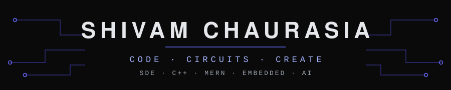
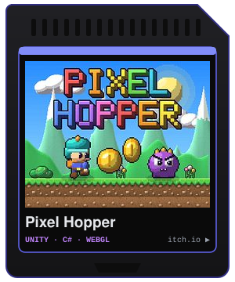
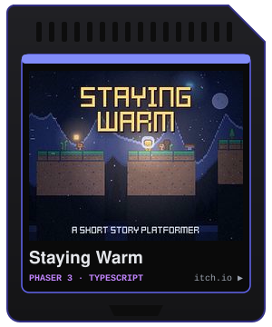
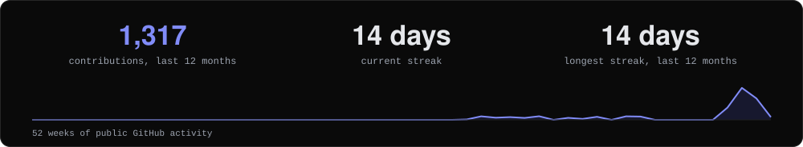
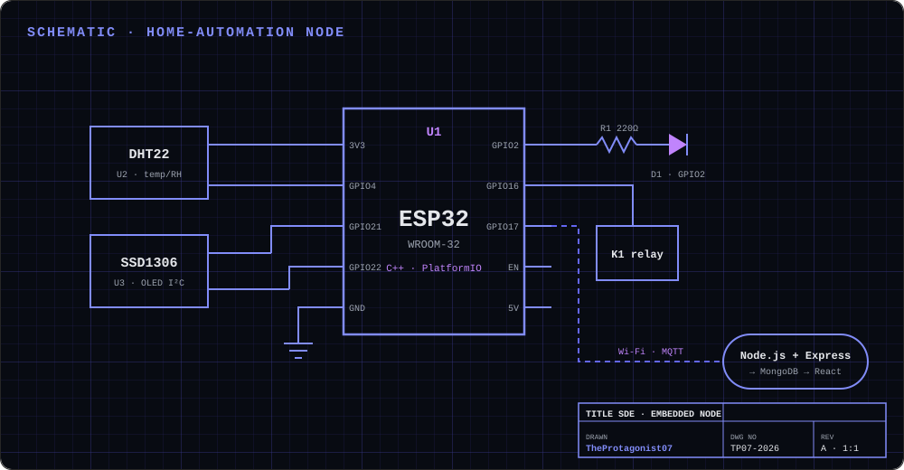
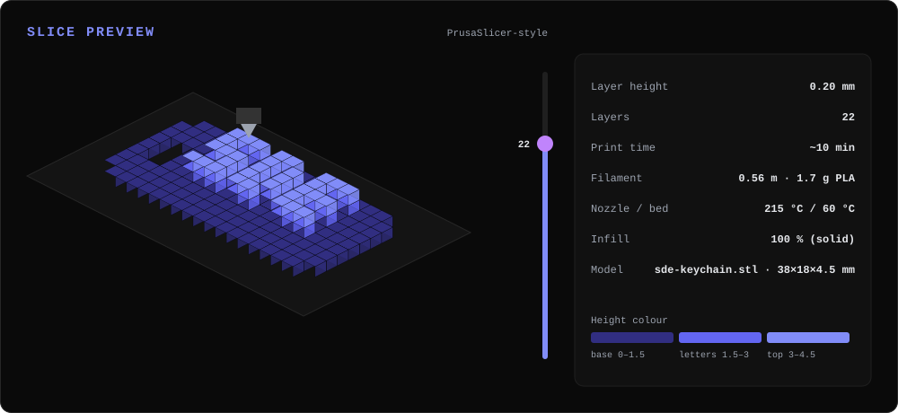

<p align="center"></p>

<p align="center">
<a href="mailto:shivamchaurasia2848@gmail.com"></a>&nbsp;
<a href="https://github.com/TheProtagonist07"></a>&nbsp;
<a href="https://github.com/TheProtagonist07?tab=followers"></a>
</p>

## 🧑‍💻 About me

```typescript
const me = {
  role:      "SDE",
  degree:    "B.Tech · Electronics & Communication Engineering",
  building:  ["AI agents and local LLM setups", "WhatsApp medicine ordering", "a quant research lab"],
  interests: ["Web Dev", "Embedded Systems", "ML", "3D Modelling"],
  hardware:  ["ESP32", "STM32", "Jetson Nano", "Embedded Systems", "Bambu Lab P1S", "Creality Ender 3"],
  daily:     "Linux machines",
  funFact:   "Software × Circuits × Creative tools in one workflow",
  openTo:    ["Full-time Roles", "Open Source", "Collabs"],
};
```

## 🛠️ Tech stack

<table>
<tr>
<td width="22%" valign="middle"><b>Frontend and full stack</b><br/><sub>C++ and the MERN stack</sub></td>
<td valign="middle"></td>
</tr>
<tr>
<td valign="middle"><b>Data science and ML</b></td>
<td valign="middle"> </td>
</tr>
<tr>
<td valign="middle"><b>Hardware and embedded</b></td>
<td valign="middle"> </td>
</tr>
<tr>
<td valign="middle"><b>3D and creative</b></td>
<td valign="middle"><br/><sub>Started with an Ender 3, now running a Bambu Lab P1S for all my 3D printing needs.</sub></td>
</tr>
<tr>
<td valign="middle"><b>Tools</b></td>
<td valign="middle"> </td>
</tr>
</table>

## 🚀 Featured project

<table>
<tr>
<td width="52%" valign="top"><a href="https://theprotagonist07.github.io/forma-studio/"></a></td>
<td width="48%" valign="top">
<b><a href="https://github.com/TheProtagonist07/forma-studio">forma-studio</a></b><br/>
A digital design museum for an original 3D design and manufacturing studio, built as design mockups for a future production site.<br/><br/>
<b>What it does</b><br/>
· Four collection rooms, each with its own palette, typography and motion<br/>
· A parametric configurator: sliders reshape a live 3D model while price, weight and print time update<br/>
· An in-browser STL quote engine that analyses the mesh without uploading the file<br/><br/>
<b>Stack</b>: HTML, CSS, vanilla JavaScript, no build step, no 3D library<br/><br/>
<a href="https://theprotagonist07.github.io/forma-studio/"><b>Live demo →</b></a> &nbsp;·&nbsp; <a href="https://github.com/TheProtagonist07/forma-studio">Source</a>
</td>
</tr>
</table>

<table>
<tr>
<td width="24%" valign="top"><a href="https://flowboard-kanban-sigma.vercel.app"></a></td>
<td valign="top"><b><a href="https://github.com/TheProtagonist07/flowboard-kanban">flowboard-kanban</a></b> <sub>side project, currently parked</sub><br/>
A Kanban board with drag-and-drop columns, WIP limits, a Pomodoro timer and 8 themes. It runs in the browser with no backend, with an optional Supabase team mode. React, TypeScript, Tailwind CSS, Vite. <a href="https://flowboard-kanban-sigma.vercel.app">Live</a> · <a href="https://github.com/TheProtagonist07/flowboard-kanban">Source</a></td>
</tr>
</table>

## 🔒 Projects with ongoing work

<table>
<tr>
<td width="22%" valign="top">🔒 <b>Quant Research Platform</b><br/><sub>private · Python</sub></td>
<td valign="top">A personal quantitative research lab, with Indian equities as the main market and crypto as a research track. It collects market data, backtests strategies and reports every result after transaction costs and taxes. Most of the code exists to stop survivorship bias, look-ahead bias and flattering equity curves from fooling me. Built with pandas, NumPy, SQLAlchemy, vectorbt and PostgreSQL. <i>Updates coming soon.</i></td>
</tr>
<tr>
<td valign="top">🔒 <b>device-profiler</b><br/><sub>private · Python</sub></td>
<td valign="top">Point it at an Android device such as a TV, set-top box or old tablet and it reads the hardware over ADB. It then scores the device as viable, limited or not viable for concrete uses, with the reasons and first steps for each. It grew out of reviving an old tablet as a wall panel and debloating a smart TV. Written in Python 3 with no dependencies beyond adb. <i>Updates coming soon.</i></td>
</tr>
<tr>
<td valign="top">🔒 <b>Hermes Gateway</b><br/><sub>private · Node.js · TypeScript</sub></td>
<td valign="top">A private, self-hosted AI assistant that runs only on my own network, made of a gateway, an orchestrator and a chat UI. It reads my goals and project notes before answering, routes each message to the cheapest capable model, and captures thoughts back into my notes. It can also operate Home Assistant and allowlisted Docker containers through MCP tools. <i>Updates coming soon.</i></td>
</tr>
<tr>
<td valign="top">🔒 <b>Gameplay Story Shorts</b><br/><sub>private · Python</sub></td>
<td valign="top">A pipeline that turns mobile-game screen recordings into story-driven vertical Shorts. It finds every match, reads what happened, and renders a 9:16 video with a moving camera, captions, a score bug, original music and sound design, and a thumbnail. It then tracks how each video performs so the next one is better. First used on my own Clash Royale matches, with colour grading in DaVinci Resolve. <i>Updates coming soon.</i></td>
</tr>
<tr>
<td valign="top">🔒 <b>MedsGenie</b><br/><sub>private · n8n · PostgreSQL · Next.js</sub></td>
<td valign="top">A WhatsApp-first medicine ordering platform: a customer sends a message or a prescription photo, the order goes to a nearby pharmacy for review, and a courier delivers it, all inside one chat. An LLM handles only the conversation, while every price, route and order status is deterministic code. It is self-hosted with Docker Compose and has a Next.js ops console. <i>Updates coming soon.</i></td>
</tr>
</table>

<sub>Forma Studio, listed above, is public. These five stay private, so there are no links yet.</sub>

### 🧭 Next up
<sub>Future plans, not current work.</sub>

- **Robotics**: the direction I want to head toward next.
- **forma-studio**: a Next.js and PostgreSQL storefront, with an order pipeline automated through n8n.
- **Quant Research Platform**: the pre-registered 500-stock experiments, then paper trading and time-series-safe machine learning.

## 🤝 Open source
| Project | Contribution | Status |
|---|---|---|
| [bloks](https://github.com/hamedgitty/bloks) (local-first AI agent workspace) | Find a real shell for engine installs on Linux machines without zsh, [#307](https://github.com/hamedgitty/bloks/pull/307) | Shipped in [v2.11.0](https://github.com/hamedgitty/bloks/releases/tag/v2.11.0) |
| [bloks](https://github.com/hamedgitty/bloks) | Give a flaky batched sweep test a different file size every turn, [#308](https://github.com/hamedgitty/bloks/pull/308) | Shipped in [v2.11.0](https://github.com/hamedgitty/bloks/releases/tag/v2.11.0) |
| [bloks](https://github.com/hamedgitty/bloks) | Issue: detect Ollama at `OLLAMA_HOST`, [#309](https://github.com/hamedgitty/bloks/issues/309) | Fixed in [v2.11.0](https://github.com/hamedgitty/bloks/releases/tag/v2.11.0) |
| [raylib](https://github.com/raysan5/raylib) | Fix a heap-buffer-overflow when saving KTX images, [#6290](https://github.com/raysan5/raylib/pull/6290) | Merged |
| [raylib](https://github.com/raysan5/raylib) | Skip the GLFW workarea clamp when the reported size is invalid, [#6296](https://github.com/raysan5/raylib/pull/6296) | Merged |
| [github-readme-streak-stats](https://github.com/DenverCoder1/github-readme-streak-stats) | Correct Hindi and Bhojpuri spelling, [#942](https://github.com/DenverCoder1/github-readme-streak-stats/pull/942) | Merged |

## 🎮 Hobby
I make small games in my spare time.

<table>
<tr>
<td align="center" valign="top"><a href="https://the-protagonist07.itch.io/pixel-hopper"></a><br/><a href="https://the-protagonist07.itch.io/pixel-hopper"><b>Pixel Hopper</b></a></td>
<td align="center" valign="top"><a href="https://the-protagonist07.itch.io/staying-warm"></a><br/><a href="https://the-protagonist07.itch.io/staying-warm"><b>Staying Warm</b></a></td>
</tr>
</table>

## 📈 Stats
<p align="center"></p>

<details>
<summary><b>Extras: embedded and 3D printing, in pictures</b></summary>

<table>
<tr>
<td width="50%" valign="top"><b>🔌 Embedded</b><br/></td>
<td width="50%" valign="top"><b>🖨️ 3D Printing</b><br/></td>
</tr>
</table>

</details>

<p align="center"><a href="mailto:shivamchaurasia2848@gmail.com">Email</a> &nbsp;·&nbsp; <a href="https://github.com/TheProtagonist07?tab=repositories">Repositories</a> &nbsp;·&nbsp; <a href="https://github.com/TheProtagonist07?tab=followers">Followers</a></p>
